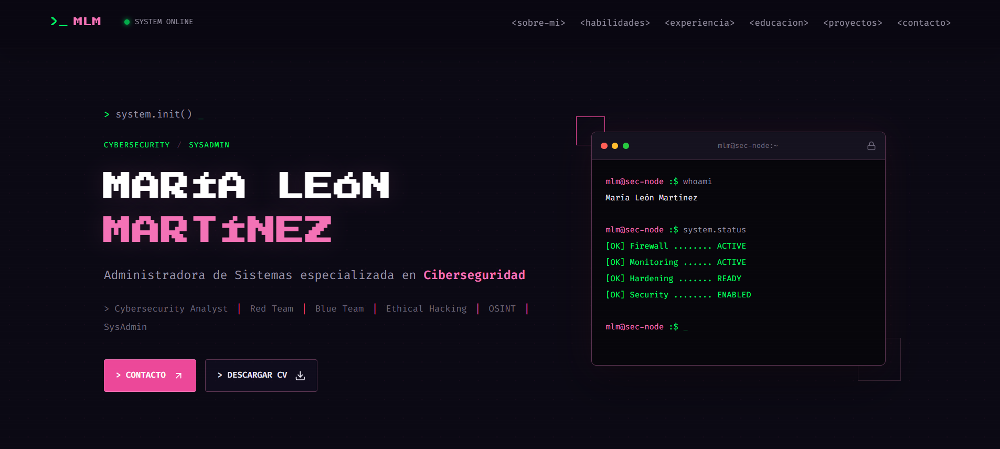

# `root@marialabs:~# whoami`

<p align="center">
  
</p>

<p align="center">
  <a href="https://mar1alabs.github.io/mar1aportfolio/">
    
  </a>
  <a href="./CV_ML_CIBER.pdf">
    
  </a>
  <a href="https://github.com/mar1alabs">
    
  </a>
</p>

```bash
┌──(mery㉿cyberlab)-[~]
└─$ cat about_me.txt
```

### 👩🏻‍💻 ABOUT ME

¡Hola! Soy **María León Martínez**, y estoy construyendo mi camino profesional en el mundo de la tecnología.

🎓 Máster en Ciberseguridad e Inteligencia Artificial.

☁️ Formación en Cloud Computing con Amazon Web Services (AWS) — UPV.

🔐 Interesada en ciberseguridad, administración de sistemas y protección de infraestructuras.

💻 Me gusta aprender, experimentar y convertir la teoría en proyectos prácticos.

### 🗂️ PROJECTS

```bash
$ ls ./projects
```

- **DC:9 — VulnHub:** laboratorio práctico de pentesting y análisis de vulnerabilidades.
- **Machine Learning & XAI:** proyecto de aprendizaje automático y explicabilidad mediante SHAP.

### 🛠️ TECH STACK

<p align="center">
  
  
  
  
  
</p>

### 📡 FIND ME

- 🌐 **Portfolio:** https://mar1alabs.github.io/mar1aportfolio/
- 📄 **Currículum:** [CV_ML_CIBER.pdf](./CV_ML_CIBER.pdf)
- 💼 **LinkedIn:** [Mi perfil profesional](PEGA_AQUI_TU_URL_DE_LINKEDIN)
- 🐙 **GitHub:** [@mar1alabs](https://github.com/mar1alabs)

```bash
┌──(mery㉿cyberlab)-[~]
└─$ echo "Learning. Building. Securing."
```

<p align="center">
  
</p>
